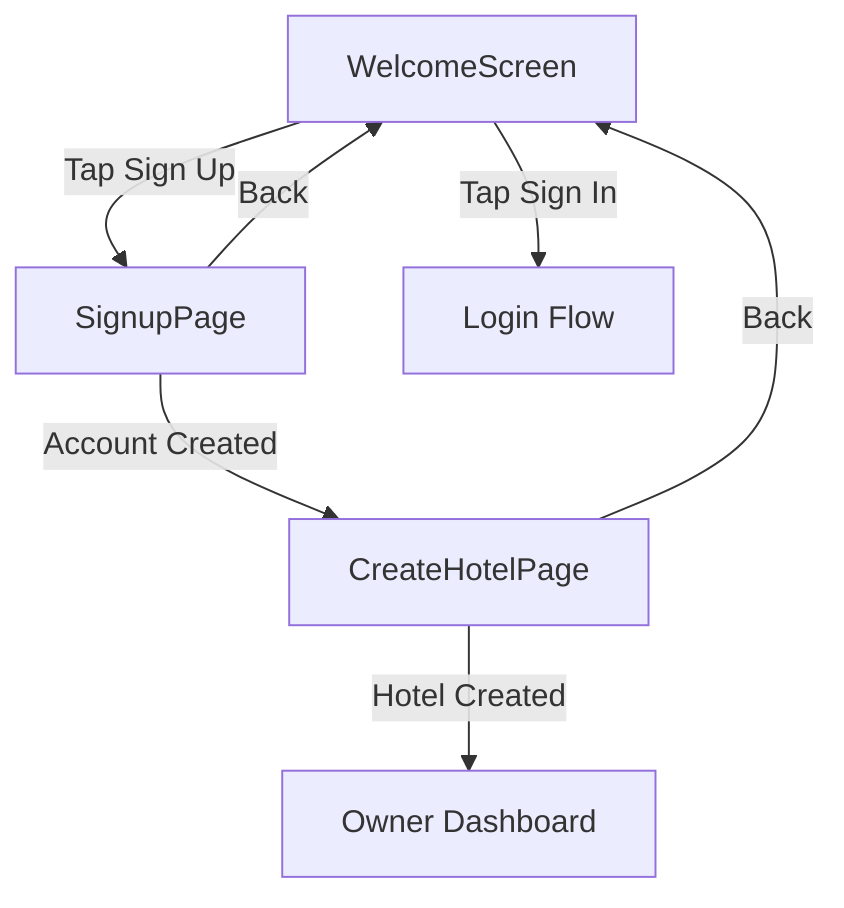

# Design Document: Owner Signup Flow

## Overview

This feature adds a streamlined signup flow for new hotel owners to the ROOMS.io
app. The implementation will:

1. Add a "Sign Up" button to the existing `WelcomeScreen`
2. Create a new `SignupPage` for account creation (email, password, confirm
   password)
3. Create a simplified `CreateHotelPage` for initial hotel setup
4. Remove the old, unused `HotelSetupWizardPage` and related files
5. Update routing to support the new flow

The flow is: Welcome Screen → Sign Up → Create Hotel → Owner Dashboard

## Architecture



### File Structure

```
lib/src/features/auth/presentation/pages/
├── welcome_screen.dart      # Modified: Add Sign Up button
├── signup_page.dart         # NEW: Account creation form
├── login_page.dart          # Unchanged
└── hotel_selection_page.dart # Unchanged

lib/src/features/hotel_setup/presentation/pages/
├── add_hotel_page.dart      # Unchanged (used for adding additional hotels)
├── create_hotel_page.dart   # NEW: Simplified hotel creation for signup flow
└── hotel_setup_wizard_page.dart  # DELETED

lib/src/features/hotel_setup/presentation/widgets/
├── owner_auth_step.dart     # DELETED
├── wizard_step_pages.dart   # DELETED
└── setup_form_widgets.dart  # Keep (may be reused)
└── floor_range_input.dart   # Keep (reused in create_hotel_page)

lib/src/core/routing/
└── app_router.dart          # Modified: Add /signup route, remove /setup route
```

## Components and Interfaces

### 1. SignupPage

A new stateful widget for account creation.

```dart
class SignupPage extends ConsumerStatefulWidget {
  // Form controllers
  final _emailController = TextEditingController();
  final _passwordController = TextEditingController();
  final _confirmPasswordController = TextEditingController();
  
  // State
  bool _isLoading = false;
  bool _obscurePassword = true;
  bool _obscureConfirmPassword = true;
  
  // Methods
  Future<void> _handleSignup();
  String? _validateEmail(String? value);
  String? _validatePassword(String? value);
  String? _validateConfirmPassword(String? value);
}
```

### 2. CreateHotelPage

A simplified hotel creation page for the signup flow.

```dart
class CreateHotelPage extends ConsumerStatefulWidget {
  // Form controllers
  final _nameController = TextEditingController();
  final _addressController = TextEditingController();
  final _phoneController = TextEditingController();
  final _emailController = TextEditingController();
  
  // Floor configuration
  int _totalFloors = 1;
  Map<int, int> _roomsPerFloor = {1: 10};
  
  // State
  bool _isLoading = false;
  
  // Methods
  Future<void> _createHotel();
  void _updateFloors(int newValue);
}
```

### 3. Modified WelcomeScreen

Add a Sign Up button below the Sign In button.

```dart
// In _buildLoginForm(), after the Sign In button:
const SizedBox(height: 16),
Row(
  mainAxisAlignment: MainAxisAlignment.center,
  children: [
    Text("Don't have an account? ", style: TextStyle(color: AppColors.grey400)),
    TextButton(
      onPressed: () => context.push(AppRoutes.signup),
      child: Text('Sign Up', style: TextStyle(color: AppColors.info)),
    ),
  ],
),
```

### 4. Router Updates

```dart
// Add new route
static const String signup = '/signup';

// Add route definition
GoRoute(
  path: AppRoutes.signup,
  pageBuilder: (context, state) => CustomTransitionPage(
    child: const SignupPage(),
    // ... transitions
  ),
),

GoRoute(
  path: AppRoutes.createHotel,
  pageBuilder: (context, state) => CustomTransitionPage(
    child: const CreateHotelPage(),
    // ... transitions
  ),
),

// Remove /setup route and HotelSetupWizardPage reference
```

## Data Models

No new data models required. The feature uses existing models:

- `User` from `auth/domain/entities/user_new.dart`
- `Hotel` from `hotel_setup/domain/entities/hotel_new.dart`
- `FloorConfig` from `hotel_setup/domain/entities/hotel_new.dart`

## Correctness Properties

_A property is a characteristic or behavior that should hold true across all
valid executions of a system-essentially, a formal statement about what the
system should do. Properties serve as the bridge between human-readable
specifications and machine-verifiable correctness guarantees._

### Property 1: Valid signup creates account

_For any_ valid email and password (6+ characters), submitting the signup form
should result in a new user account being created in the system. **Validates:
Requirements 1.4**

### Property 2: Invalid email format rejected

_For any_ string that does not contain an '@' character, the email validation
should return an error message. **Validates: Requirements 5.2**

### Property 3: Short password rejected

_For any_ password string with fewer than 6 characters, the password validation
should return an error message. **Validates: Requirements 5.3**

### Property 4: Mismatched passwords rejected

_For any_ two different password strings, the confirm password validation should
return an error message when they don't match. **Validates: Requirements 5.4**

### Property 5: Valid hotel data creates hotel

_For any_ valid hotel name and address (non-empty strings), submitting the hotel
creation form should result in a new hotel being created and associated with the
current user. **Validates: Requirements 2.4**

## Error Handling

### Signup Errors

| Error Condition      | User Message                             | Recovery                     |
| -------------------- | ---------------------------------------- | ---------------------------- |
| Empty email          | "Please enter your email"                | Focus email field            |
| Invalid email format | "Please enter a valid email"             | Focus email field            |
| Short password       | "Password must be at least 6 characters" | Focus password field         |
| Mismatched passwords | "Passwords do not match"                 | Focus confirm password field |
| Email already exists | "Email already registered"               | Show snackbar, suggest login |
| Network error        | "Connection failed. Please try again."   | Show retry option            |

### Hotel Creation Errors

| Error Condition  | User Message                        | Recovery                 |
| ---------------- | ----------------------------------- | ------------------------ |
| Empty hotel name | "Hotel name is required"            | Focus name field         |
| Empty address    | "Address is required"               | Focus address field      |
| Database error   | "Failed to create hotel: [details]" | Show snackbar with retry |

## Testing Strategy

### Unit Tests

- Test form validation functions in isolation
- Test that validators return correct error messages for invalid inputs
- Test that validators return null for valid inputs

### Property-Based Tests

The following properties will be tested using the `flutter_test` package with
custom generators:

1. **Email validation property**: Generate random strings, verify that strings
   without '@' are rejected
2. **Password length property**: Generate random strings of varying lengths,
   verify that strings < 6 chars are rejected
3. **Password match property**: Generate pairs of random strings, verify that
   non-matching pairs are rejected
4. **Hotel creation property**: Generate valid hotel data, verify hotel is
   created with correct owner association

Property-based tests will use the `dart_check` package for property testing with
a minimum of 100 iterations per property.

Each property test will be tagged with a comment referencing the correctness
property:

```dart
// **Feature: owner-signup-flow, Property 2: Invalid email format rejected**
test('email validation rejects strings without @', () {
  // Property test implementation
});
```

### Widget Tests

- Test that SignupPage renders all required form fields
- Test that CreateHotelPage renders all required form fields
- Test navigation from WelcomeScreen to SignupPage
- Test navigation from SignupPage to CreateHotelPage after successful signup
